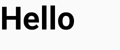
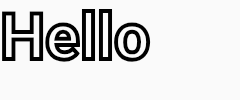

# `DrawScope.drawText` without a `drawStyle` keeps the last draw's stroke

Drawing a `TextLayoutResult` with `drawStyle = Stroke(...)` and then drawing the same layout again without a `drawStyle` strokes the text a second time instead of filling it. The common case is a halo: draw the label as a wide outline in the background color, then draw it on top in the text color. The top draw comes out as an outline, so the label reads as a blob.

`drawText`'s `drawStyle` defaults to `null`, which `TextPainter.kt` resolves to the layout's own `TextStyle.drawStyle`. That is also `null` for a plain style, and `AndroidTextPaint.setDrawStyle(null)` returns early, so the paragraph's paint keeps the `Stroke` from the previous draw. `AndroidParagraph.paint` saves and restores the paint's `blendMode` around a draw, but not its draw style. `setShadow(null)` and `setTextDecoration(null)` return early the same way.

## Reproduction

```sh
./gradlew test                          # Compose 1.12.1, the latest stable release
./gradlew test -Pcompose=1.13.0-beta02  # the latest beta
```

`DrawTextDrawStyleTest` draws "Hello" in black in two canvases, each with its own `TextMeasurer` so they don't share a cached layout. One passes `drawStyle = Fill` and the other passes no `drawStyle`. Both should paint the same pixels.

- `noDrawStyleFillsTheText`: nothing drawn before. Passes.
- `noDrawStyleFillsTheTextAfterAStrokedDrawOfTheSameLayout`: each canvas first draws the same layout as a 4 px white outline, as a halo would. Fails.

Output, the same on 1.12.1 and 1.13.0-beta02:

```
    after-stroke: 4527 of 24000 pixels differ between drawStyle = Fill and no drawStyle
DrawTextDrawStyleTest > noDrawStyleFillsTheTextAfterAStrokedDrawOfTheSameLayout FAILED
    java.lang.AssertionError at DrawTextDrawStyleTest.kt:82
    plain: 0 of 24000 pixels differ between drawStyle = Fill and no drawStyle
2 tests completed, 1 failed
```

The test writes its captures to `repro/build/outputs/`. After the stroked draw, `drawStyle = Fill` gives filled text and no `drawStyle` gives an outline:

| `drawStyle = Fill` | no `drawStyle` |
| --- | --- |
|  |  |

## Expected

`drawText(layout, Color.Black)` fills the text, as `drawText(layout, Color.Black, drawStyle = Fill)` does, whatever an earlier draw of the same layout used.

## Actual

The text is stroked with the earlier draw's `Stroke`. In ui-text 1.12.1 and 1.13.0-beta02:

- `TextPainter.kt`, `DrawScope.drawText(textLayoutResult, …)`: `val newDrawStyle = drawStyle ?: textLayoutResult.layoutInput.style.drawStyle`, which is `null` for a style without a `drawStyle`.
- `AndroidParagraph.android.kt`, `paint(canvas, color, shadow, textDecoration, drawStyle, blendMode)`: calls `textPaint.setDrawStyle(drawStyle)` and restores only `blendMode` afterwards.
- `AndroidTextPaint.android.kt`, `setDrawStyle`: `if (drawStyle == null) return`.

Possible fixes: treat a `null` resolved style as `Fill` in `drawText`, or restore the paint's draw style (and shadow and decoration) after `paint`, as `blendMode` is.

Workaround: pass `drawStyle = Fill` explicitly.

## Environment

- androidx.compose.ui:ui-text 1.12.1 (compose-bom 2026.09.00) and 1.13.0-beta02
- AGP 9.5.0, Kotlin 2.4.21, Robolectric 4.17 (native graphics), JDK 25
- macOS 27.2
